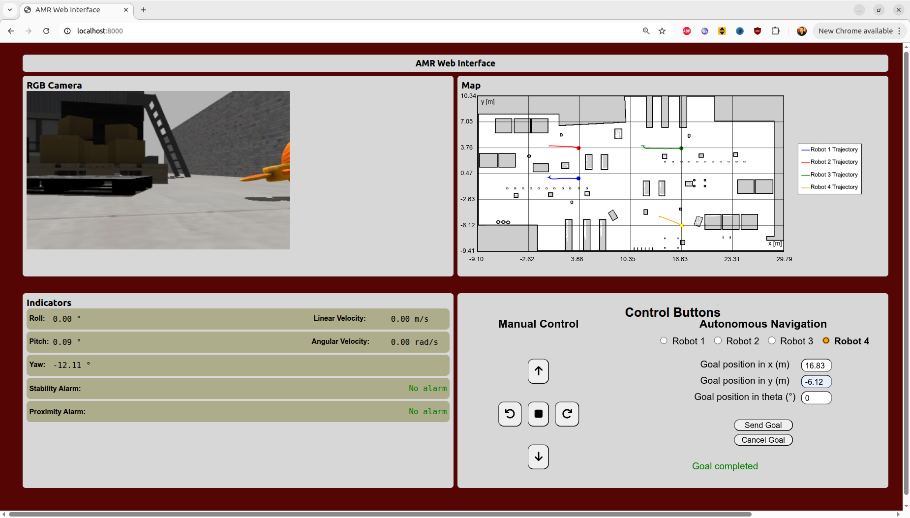
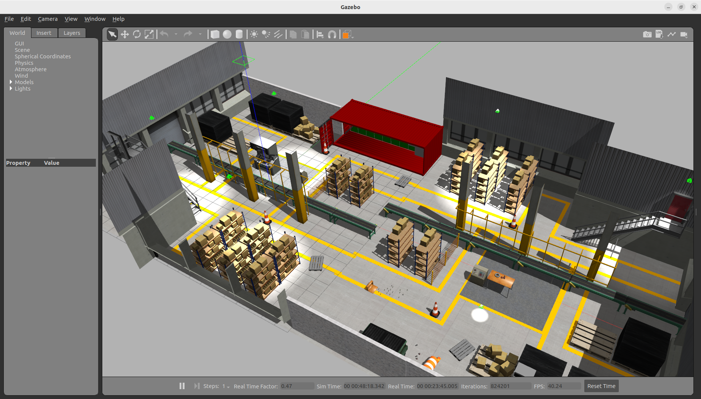

# Ejecución de la interfaz web
## 1. Requisitos previos
* Tener instalado ROS 2 Humble
* Tener instalado los paquetes del robot móvil `TurtleBot 3`
* Tener instalado Gazebo Classic
* Tener instalado los paquetes `Nav2`, `rosbridge_server` y `web_video_server`
## 2. Pasos para inicializar el sistema
### 2.1 Clonación del repositorio
```bash
git clone https://github.com/lfvargas20/Monitoreo_Control_Web_Multirobot.git
```
### 2.2 Eliminación de las carpetas build, install y log
```bash
cd ~/Interfaces_Web_Movil_ROS
```
```bash
rm -rf /build /install /log
```
### 2.3 Compilación
```bash
colcon build --symlink-install
```
```bash
source install/setup.bash
```
### 2.4 Comando de activación del proyecto (Terminal 1)
```bash
ros2 launch amr multi_amr_project_launch.launch.py
```
### 2.5 Comandos para activar el servidor local de la página web de monitoreo y control de los robots (Terminal 2)
```bash
cd ~/Interfaces_Web_Movil_ROS/interfaces/web
```

```bash
python3 -m http.server
```
## 3. Dirección local de la página web
[Página web](https://localhost:8000)
## 4. Visualización de la página web

## 5. Visualización del entorno industrial en Gazebo Classic

