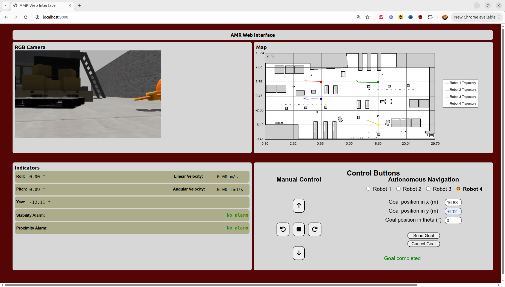
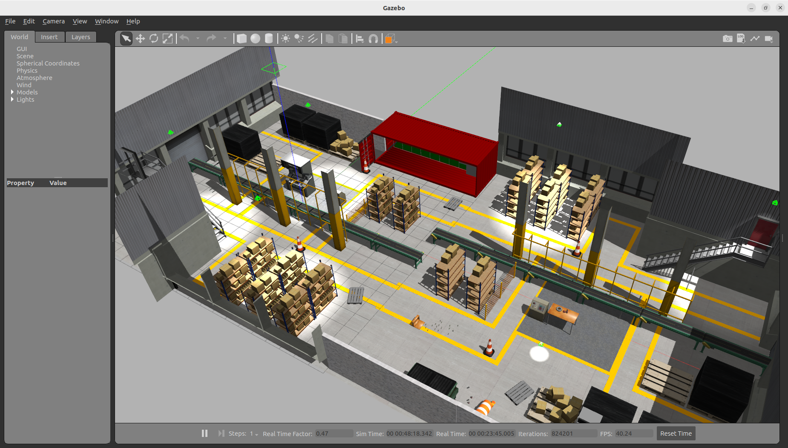

# Web Interface Execution

## 1. Prerequisites

* ROS 2 Humble installed
* `TurtleBot 3` mobile robot packages installed
* Gazebo Classic installed
* `Nav2`, `rosbridge_server`, and `web_video_server` packages installed

## 2. Steps to Initialize the System

### 2.1 Removal of build, install, and log folders

```bash
cd ~/Interfaces_Web_Movil_ROS
```

```bash
rm -rf /build /install /log
```

### 2.2 Compilation

```bash
colcon build --symlink-install
```

```bash
source install/setup.bash
```

### 2.3 Project Activation Command (Terminal 1)

```bash
ros2 launch amr multi_amr_project_launch.launch.py
```

### 2.4 Commands to Activate the Local Server for the Web Monitoring and Control Interface (Terminal 2)

```bash
cd ~/Interfaces_Web_Movil_ROS/interfaces/web
```

```bash
python3 -m http.server
```

## 3. Local Web Page Address

[Web page](https://localhost:8000)

## 4. Web Page Preview



## 5. Industrial Environment Preview in Gazebo Classic

